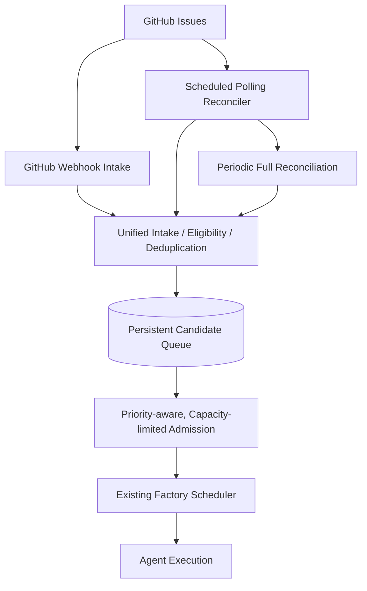

# Cezar Factory Enhancement: Reliable GitHub Issue Intake & Reconciliation

**Status:** Proposed  
**Target repository:** `bin0110001/cezar-factory`  
**Purpose:** Make GitHub issue discovery and admission a reliable first-class Factory capability, replacing the recovery skill workaround once proven.

## 1. Problem and goals

Cezar currently supports GitHub issue flag/label triggers, but the event-driven trigger is not consistently firing. A recovery skill periodically looks for eligible issues that were missed. This is a useful temporary safeguard but should become a supported, configurable and observable feature.

**Goals**

- Discover eligible GitHub issues reliably, even when webhook events are missed.
- Allow polling frequency, batch sizes, eligibility filters, and repository overrides to be configured.
- Prevent duplicate work from overlapping webhook and polling discoveries.
- Limit newly admitted work without preventing discovery of the backlog.
- Respect existing issue priority, dependencies, file-conflict scheduling, agent capacity, and model/subscription quotas.
- Recover from restarts, API outages, cursor errors, and stale intake state.
- Provide a clear UI for configuration, health, and explanation of why an issue is or is not executing.
- Prefer deterministic code for polling, matching, deduplication, queueing and retry handling; no LLM required for these operations.

## 2. Proposed architecture



Webhooks offer low latency; polling ensures eventual recovery. **Neither input mechanism directly dispatches an agent.** Both feed a unified intake pipeline. GitHub remains the authoritative source of issue eligibility, while Factory persists local discovery/admission/execution state.

## 3. Configuration

Support global defaults with per-repository overrides. Proposed schema (subject to fitting existing configuration conventions):

```yaml
github_intake:
  enabled: true
  mode: hybrid                 # hybrid | poll | webhook
  poll_interval_minutes: 5
  required_labels:
    - "factory:ready"          # illustrative: align with current labels
  max_issues_examined_per_poll: 100
  max_new_admissions_per_cycle: 5
  initial_sync: eligible       # eligible | new_only
  retry_stale_intake: true
  full_reconcile_interval_hours: 24
  api_backoff_enabled: true
  repository_overrides: {}
```

The **three distinct capacity limits** are:

| Limit | What it controls | Suggested default |
|---|---|---|
| Issues examined per poll | GitHub API volume and reconciliation workload | 100 |
| New issues admitted per cycle | How much newly queued work can enter the scheduler | 5 |
| Concurrent executing jobs | How many agents/jobs run simultaneously | Reuse existing scheduler setting |

These limits must not be conflated. In particular, when admission capacity is exhausted, discovered issues must still remain in the persistent candidate queue. The poller must continue paginating and maintaining cursors correctly rather than repeatedly seeing only the newest batch.

Additional operational controls to consider:

- Poll interval and jitter; manual `reconcile now` action and dry-run preview.
- Repository enable/disable, required/excluded labels, issue state filters, and per-repo weights.
- Maximum GitHub API pages/requests per cycle and secondary rate-limit backoff.
- Retry policy and stale intake timeout.
- Incremental cursor overlap window and full-reconciliation cadence.
- Webhook secret verification, delivery ID tracking, and dedupe retention.
- Global versus per-repository admission limits, using fairness to prevent a busy repository from starving smaller projects.

## 4. Intake lifecycle and idempotency

Suggested durable states:

```text
Discovered -> Eligible -> Queued -> Admitted -> Dispatched
                  |          |          |
                  +----------+----------+--> Deferred / Blocked / Ineligible

Errors -> Retry pending -> Reconcile / Reevaluate
```

Each transition should be persisted with timestamp, reason, source (`webhook`, `poll`, or `manual`), and correlation ID. Separate *logical intake identity* from an *execution attempt ID* so retries of a failed agent run are possible without duplicating logical work.

Use stable GitHub repository and issue IDs to identify logical candidates. Enforce uniqueness through the database/transaction boundary, not just application-level checks. Before admission, re-fetch or otherwise validate sufficiently current issue state; eligibility may have changed during the poll.

Expected conditions:

| Scenario | Required behavior |
|---|---|
| Webhook missed | Polling discovers the issue on a later cycle |
| Duplicate webhook or webhook + poll overlap | One logical candidate; no duplicate dispatch |
| GitHub API outage/rate limit | Bounded exponential backoff; preserve cursors; resume later |
| Factory process restart mid-poll | Durable resume and idempotent replay |
| Eligible label removed | Reevaluate; cancel pending admission if no longer eligible |
| Issue blocked by dependency | Retain visible candidate, no premature dispatch |
| Agent run fails | Use existing execution retry policy, not rediscovery as a new job |
| No agent/model capacity | Keep candidate queued until scheduler can execute |
| Multiple pollers | Lease/leader coordination prevents inconsistent cursor writes |
| Issue changes during scan | Check eligibility again at admission |
| Cursor invalid or missed pages | Periodic full reconciliation repairs drift |

Incremental `updated_at` scanning is efficient, but a periodic **full scan of eligible issues** is needed for eventual consistency and cursor repair. Design overlap/deduplication around GitHub search pagination and indexing limitations; don't assume exact-once event delivery or an exact snapshot.

## 5. Scheduling integration

The intake subsystem should **not** recreate the Factory priority or scheduling engines.

- **Priority and backlog:** Discover all eligible candidates; existing priority logic selects candidates for admission. Do not admit merely the first N issues returned by GitHub.
- **Dependencies:** Keep blocked issues in the candidate backlog and reevaluate when their dependencies resolve, whether or not GitHub sends another webhook.
- **File/worktree conflicts:** Use existing planned conflict-aware scheduling. Admission must not bypass ownership/coordination constraints.
- **Agent capacity:** Use the existing concurrent-job limit to control running work.
- **Model families and subscriptions:** Keep discovered issues queued when a required model tier or subscription lacks capacity.
- **Repository fairness:** Apply per-repository weights or a fair scheduling policy so one large project cannot monopolize admission slots.
- **Recovery skill:** Keep temporarily as a diagnostic fallback; remove independent scheduling authority after the native service is verified.

## 6. UI and operational visibility

Add an **Issue Intake** area to the existing Factory administration UI, including:

- Global configuration and repository-level overrides.
- Discovery mode, poll frequency, labels, scan batch size, admission limit and initial-sync options.
- Last successful reconciliation, next scheduled run, duration, errors, API throttling and cursor position.
- Counts for discovered, queued, admitted, blocked, deferred, recovered-by-polling and failed candidates.
- Searchable per-issue intake history and reason codes explaining why an issue is waiting.
- Manual reconciliation with a dry-run option and estimated issue changes.
- Alerts for prolonged reconciliation failures, old queue entries, or suspicious webhook/poll discrepancies.

Use structured logs and conventional metrics for deterministic intake operations. Link traces into the planned Langfuse observability approach where agent-driven reasoning or decisions are involved; don't introduce LLM calls for deterministic state reconciliation.

## 7. Proposed issue breakdown

Create one **parent enhancement** and six linked implementation issues. These are planning items, **not yet created on GitHub**.

### Issue 1 — Durable GitHub issue intake service (P0)

**Scope:** Unified webhook and poll ingestion; eligibility evaluator; durable issue identity and lifecycle state; database-level deduplication.

**Tasks**
- [ ] Audit existing webhook trigger and recovery skill implementation.
- [ ] Define persisted intake schema, reason codes and transition rules.
- [ ] Route webhook inputs through unified intake service.
- [ ] Implement transactional upsert and uniqueness guarantees.
- [ ] Ensure pending candidates are not dispatched directly by ingestion.
- [ ] Expose service interfaces for poller, UI and scheduler.

**Acceptance**
- [ ] Two discoveries of the same eligible issue create one candidate.
- [ ] An issue's intake state and provenance can be inspected.
- [ ] Dispatch is controlled only by the scheduler/admission path.

### Issue 2 — Configurable GitHub polling & reconciliation (P0)

**Depends on:** Issue 1 interfaces/state schema.

**Tasks**
- [ ] Implement per-repository incremental polling with durable cursors.
- [ ] Implement configurable polling interval, jitter and eligibility filters.
- [ ] Implement page limits and maximum issues examined per cycle.
- [ ] Handle pagination, API rate limiting, retries and cursor overlap.
- [ ] Add periodic full reconciliation for recovery from drift.
- [ ] Support global defaults and repository overrides.
- [ ] Add initial-sync behavior: existing eligible issues or new changes only.

**Acceptance**
- [ ] A missed webhook is eventually recovered by polling.
- [ ] Cursor/resume behavior remains correct through interrupted scans.
- [ ] Rate limits delay scans without losing eligible work.

### Issue 3 — Capacity-aware, priority-aware admission (P0)

**Depends on:** Issue 1; integrate with existing scheduler and priority/dependency work.

**Tasks**
- [ ] Implement configurable max new admissions per cycle.
- [ ] Choose admission order using canonical priority and dependency readiness.
- [ ] Add fair admission across repositories.
- [ ] Keep candidates visible when execution capacity is unavailable.
- [ ] Reevaluate issue state before admission.
- [ ] Respect conflict-aware scheduling, agent limits and subscription quotas.

**Acceptance**
- [ ] A large backlog cannot flood the execution queue.
- [ ] Eligible high-priority issues can outrank lower-priority earlier discoveries.
- [ ] A full scheduler does not cause discovered candidates to disappear.

### Issue 4 — Failure recovery & consistency (P1)

**Depends on:** Issues 1 and 2; coordinate with Issue 3.

**Tasks**
- [ ] Implement multi-worker lease/leader behavior for reconciliation.
- [ ] Implement stale-state detection and controlled retry.
- [ ] Recover interrupted scans and admissions after restarts.
- [ ] Detect webhook-versus-poll gaps and drift.
- [ ] Distinguish intake retries from execution retries.
- [ ] Add deterministic fault-injection tests.

**Acceptance**
- [ ] A crash mid-poll does not lose work or duplicate dispatch.
- [ ] Multiple Factory workers cannot corrupt reconciliation state.
- [ ] Stuck candidates have visible failure reasons and recovery paths.

### Issue 5 — Intake settings and operations UI (P1)

**Depends on:** Configuration/state APIs from Issues 1–4.

**Tasks**
- [ ] Add global and per-repository intake settings.
- [ ] Add intake health overview and per-repository status.
- [ ] Show counts, recent events, cursor health and recovered missed triggers.
- [ ] Add searchable issue-state history and reason codes.
- [ ] Add manual reconcile and dry-run preview.
- [ ] Add warnings/alerts for persistently unhealthy intake.

**Acceptance**
- [ ] Operators can determine why a labeled issue has not run.
- [ ] Polling configuration can be modified without source changes.
- [ ] Manual reconcile is safe and does not bypass admission constraints.

### Issue 6 — Migration, reliability regression suite & recovery skill retirement (P1)

**Depends on:** Issues 1–5.

**Tasks**
- [ ] Map recovery skill behavior and preserve useful diagnostics.
- [ ] Test webhook missed/duplicated, outages, pagination, capacity exhaustion, label removal and concurrent workers.
- [ ] Establish measurable soak-test thresholds and monitor recovered work.
- [ ] Run native reconciliation alongside the skill without dual dispatch authority.
- [ ] Decommission the skill's scheduling role after reliability validation.
- [ ] Document operations, configuration and manual recovery steps.

**Acceptance**
- [ ] Existing eligible issues are not stranded during migration.
- [ ] There is no parallel path that can independently schedule duplicate jobs.
- [ ] Normal recovery no longer depends on an LLM skill.

## 8. Delivery phases

1. **Core reliability:** Issues 1–2 — unified durable intake and reconciliation.
2. **Scheduler integration:** Issues 3–4 — priority, capacity, fault tolerance.
3. **Operational readiness:** Issues 5–6 — UI, regression coverage, safe migration.

All implementation/testing should execute on local/self-hosted runners; **do not introduce GitHub Actions requiring paid hosted compute**.

## 9. Parent enhancement acceptance checklist

- [ ] Missed GitHub events are recovered by scheduled polling.
- [ ] Overlapping discovery sources never create duplicate logical work.
- [ ] Polling frequency, eligibility and intake limits are configurable.
- [ ] A backlog does not overwhelm execution capacity.
- [ ] Admission respects priority, dependency readiness and repository fairness.
- [ ] Existing file-conflict, agent-capacity and model-quota constraints remain enforced.
- [ ] Factory restarts and transient GitHub failures do not lose work.
- [ ] Full reconciliation repairs missed incremental updates or cursor drift.
- [ ] Operators can explain why any tracked issue has not been scheduled.
- [ ] Deterministic logic handles scanning, queueing and reconciliation without LLM involvement.
- [ ] The legacy recovery skill can be retired without losing functionality.

## 10. Design cautions

- Avoid conflating **discovery**, **admission**, and **execution concurrency**.
- Avoid making a poll's result ordering synonymous with issue priority.
- Avoid relying on webhooks alone, or on GitHub's search index as the only source of truth.
- Avoid allowing admission to silently bypass future conflict/dependency coordination.
- Avoid migrating legacy work without deduplication and auditability.
- Avoid introducing another competing orchestration or observability stack where existing Factory components suffice.
