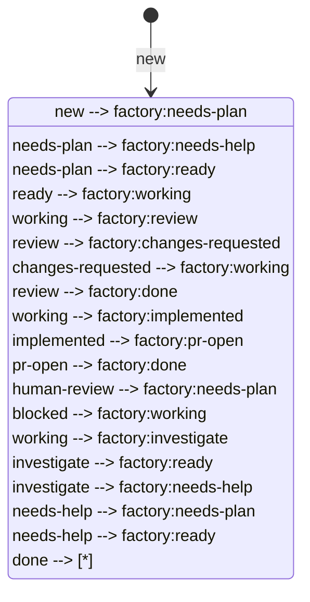

# Factory Lifecycle

This document defines the state transitions for issues in the Cezar factory.

The lifecycle is data: `policies/lifecycle.json` lists every state of a profile with its kind (automated, in-run,
human, delivery, terminal), owner, legal exits, deadline (`maxDwellHours`) and what happens at the deadline
(`onTimeout`). `scripts/lifecycle-lib.ps1` is the loader, and the suite fails when a state has no owner, no exit,
no deadline, or no automation that consumes it. A project changes its process, for example a technical-design step
with manual sign-off for risky work, by selecting or overriding a profile. Scripts are being moved from their own
label lists to this file (`STABILIZATION-PLAN.md`, item 1.4); the stale refresher, repository maintenance, audit
recovery, delivery sync and the lifecycle sweep read it today.

## The invariant, and what enforces it

Every open issue is in exactly one state, that state has an owner, and the issue has not sat there past the
state's deadline. The hourly `factory-maintenance` workflow enforces it in its `lifecycle-sweep` step
(`scripts/sweep-lifecycle.ps1`), which holds no state list of its own.

It repairs what is mechanical, at most five issues per run, each with a comment giving the evidence. An issue
marked `factory:interactive` belongs to a person, so the sweep reports what it sees and changes nothing. A repair
lands in a state the issue can stay in: an unblocked issue with no complexity label goes to planning, not to
`factory:ready`. Reading a blocked issue's description costs a call, so five are checked per run, rotating by the
hour so one that cannot be unblocked does not starve the others:

| Finding | Repair |
|---|---|
| No state label | The profile's initial state, so intake classifies it |
| A state's guard is not met (a `factory:ready` issue with no `complexity:*` label) | The guard's `otherwise` state (`factory:needs-plan`) |
| `factory:blocked` and every issue its description names as a blocker ("Blocked by #N", "Depends on #N") is closed | The state's `onUnblocked` state (`factory:ready`) |
| In review and its pull request conflicts with `dev` | The state's `onConflict` state (`factory:changes-requested`), so the fix automation repairs the PR |

Everything it must not guess goes into one rolling issue, **Factory stall report** (labelled
`factory:tracking`, rewritten in place and only when its content changes): several state labels, a blocked
issue that names no blocker, work past its deadline, a draft pull request, a pull request that names no
issue. A re-triggered state is listed after three deadlines without activity, which means its automation is
not consuming it (paused, or refusing the issue). An empty report is the first exit criterion of the
stabilization plan.

## States

- `factory:new` - Initial state when an issue is created.
- `factory:needs-plan` - Ready for planning.
- `factory:needs-help` - Paused only for an unresolved major architectural decision. An issue enters it only
  with a question a person can answer: a structured decision, the plan's unresolved questions, or the
  "narrow, split or close" choice after three investigations. A result that says "architectural decision"
  without stating one is re-planned instead, and a plan that is not ready must say what has to be answered.
- `factory:tracking` - A non-lifecycle marker for an epic or tracking parent;
  it is not executable work and does not require human intervention.
- `factory:ready` - Planning complete, ready for implementation.
- `factory:working` - Implementation in progress.
- `factory:review` - Implementation submitted for review.
- `factory:changes-requested` - Reviewer requested changes.
- `factory:human-review` - Exceptional hold for an unresolved major architectural decision. No script sets it;
  it exists for a person to apply.
- `factory:blocked` - Blocked by external dependencies. Set by a person or by the backlog label audit; the
  router never sets it. The lifecycle sweep returns it to `factory:ready` once every named blocker is closed.
- `factory:done` - Work is complete.
- `factory:investigate` - Repeated failure awaiting classification.
- `factory:implemented` - Work is complete on a pushed branch and has no PR yet. Inert: no automation consumes it.
- `factory:pr-open` - A non-draft PR into `dev` references the issue. Inert; the Factory review loop uses `factory:review` for the same stage.
- `factory:interactive` - A non-lifecycle marker for work done in a local dev window. Stale-work sweeps skip it; it is not a state.

## State table

Rendered from `policies/lifecycle.json` (the `standard` profile); a suite test fails when it is stale. Refresh it with
`pwsh -NoProfile -Command ". scripts/lifecycle-lib.ps1; Update-FactoryLifecycleDoc"`.

<!-- lifecycle-table:begin -->
| State | Kind | Owner | Exits | Deadline | At the deadline |
|---|---|---|---|---|---|
| `factory:new` | automated | `factory-intake` | `factory:needs-plan`, `factory:needs-help` | 24 h | retrigger |
| `factory:needs-plan` | automated | `factory-plan` | `factory:ready`, `factory:needs-help`, `factory:done` | 24 h | retrigger |
| `factory:ready` | automated | `factory-implement` | `factory:working`, `factory:needs-plan` | 24 h | retrigger |
| `factory:working` | in-run | `factory-implement` / `factory-fix-review` | `factory:review`, `factory:investigate`, `factory:implemented` | 24 h | investigate |
| `factory:review` | automated | `factory-review` | `factory:done`, `factory:changes-requested`, `factory:investigate` | 24 h | retrigger |
| `factory:changes-requested` | automated | `factory-fix-review` | `factory:working` | 24 h | retrigger |
| `factory:investigate` | automated | `factory-investigate` | `factory:ready`, `factory:needs-plan`, `factory:needs-help` | 24 h | retrigger |
| `factory:needs-help` | human | a person (owner) | `factory:needs-plan`, `factory:ready` | 168 h | report |
| `factory:human-review` | human | a person (owner) | `factory:needs-plan` | 168 h | report |
| `factory:blocked` | human | a person (owner) | `factory:working`, `factory:ready` | 168 h | report |
| `factory:implemented` | delivery | `factory-maintenance` | `factory:pr-open` | 72 h | report |
| `factory:pr-open` | delivery | `factory-maintenance` | `factory:done` | 168 h | report |
| `factory:done` | terminal | - | - | - | - |
<!-- lifecycle-table:end -->

## Profiles: changing the process by configuration

A profile may `extend` another and restate only the states that differ. `risk-gated` is shipped as the worked example
(`policies/lifecycle.json`): a completed plan for `risk:high` work goes to a human state, `factory:design-signoff`,
instead of `factory:ready`, and the implement automation cannot start it until a person relabels it `factory:ready`
(approve) or `factory:needs-plan` (rework). The router reads the conditional exit
(`"when": { "risk": ["risk:high"] }`) from the policy; no script names the risk label or the new state, and
`create-labels.ps1` creates a profile's own state labels.

| To | Do |
|---|---|
| Use a profile for one project | Set `FACTORY_LIFECYCLE_PROFILE=risk-gated` in that project's Cezar environment, or override `policies/lifecycle.json` in the project's `.ai/factory/overrides/policies/` and set `defaultProfile` |
| Add a gate for another risk or type | Add a conditional exit in a profile (`risk` and `type` conditions are supported) and the state it leads to |
| Check a profile | `tests/run-tests.ps1` runs the soundness check on every profile the policy ships |

A state may carry `"inFlight": true` ("an automation is mid-flow on it"); the stall detector treats it like a running
state instead of looking for an automation that consumes its label (`factory:review` and `factory:changes-requested`).

Cezar's stall detector reads this policy from the project's checkout (`policies/lifecycle.json`, or a managed
project's `.ai/factory/policies/`), counting the states of every profile, so an issue waiting at a profile-only state
such as `factory:design-signoff` is reported as waiting on a person. When the file cannot be read it uses the standard
process, as before. Limit: Cezar's Decisions screen and backlog lanes still keep their own state lists.

## Level-triggered consumers

Cezar's GitHub automations fire on a label event, once. Every `issue.labeled` automation here also sets
`fullReconcileHours: 24`: once a day it re-lists the open issues that still carry its label and recovers any labeling
the poller missed (it was paused, down, or never saw the event), and `maxAdmissionsPerCycle: 1` lets one new launch
through per poll so a recovered backlog drains slowly instead of starting at once. Intake always worked this way; the
planning, investigation and review automations now do too. The implement and fix automations deliberately do not
replay existing issues when they are enabled (`initialSync` is not `eligible`), so enabling one still baselines to now
and never launches the backlog; `fullReconcileHours` then recovers only events missed after that point. An event that
was seen and then failed is not recovered here; the stale refresher re-triggers it.

## Transitions

## Transition Rules

1. **Legal transitions** are only those shown in the diagram above.
2. **Automation ownership**:
   - `factory:needs-plan` → `factory:ready`: Planning automation; routine ambiguity is resolved with documented assumptions
   - `factory:ready` → `factory:working`: Implementation automation
   - `factory:working` → `factory:review`: Implementation automation (after completion)
   - `factory:review` → `factory:changes-requested`: Review automation
   - `factory:review` → `factory:done`: Independent review, current-head eligibility and local validation receipts pass, auto-merge is requested for that exact head, and GitHub reports the PR merged; otherwise remain in review
   - A decomposed tracking parent closes after creating and queueing its child issues; children plan and implement autonomously in dependency order.
   - `factory:changes-requested` → `factory:working`: Fix automation
   - `factory:human-review` → `factory:needs-plan`: User resolves a major architectural decision; planning resumes automatically
3. **Human-required transitions**:
   - Entry to `factory:needs-help` or `factory:human-review` only when a major architectural decision requires user input
   - User review after delivery is optional feedback, not a workflow gate
   - **PR ownership**: the implementation and fix automations own their PR until it merges. They merge the current `dev` into the branch, resolve conflicts themselves, and leave the PR `MERGEABLE` before handoff; a PR that turns `CONFLICTING` while waiting for review is repaired by the fix automation, never by the user (see `AGENTS.md`, "A job owns its pull request until it merges").
4. **Blocked work resumption**: When every blocker an issue names is closed, the lifecycle sweep returns it to
   `factory:ready` with a comment listing them. A blocked issue must name its blockers in its description
   ("Blocked by #N"); one that names none is listed in the stall report.
5. **Conflicting state prevention**: An issue can only have one factory-state label at a time.

## Where is my issue? (delivery stages)

Every issue shows its stage by label, and the stage changes as the work moves. GitHub only closes
a `Closes #N` issue when the PR merges into the *default* branch, and Factory PRs merge into
`dev`, so the maintenance workflow does the closing.

| Stage | Label | Who sets it |
|---|---|---|
| In progress | `factory:working` (+ `factory:interactive` in a dev window) | Implementation automation, or the person/agent starting the work |
| Finished, pushed, no PR | `factory:implemented` | The person/agent finishing the work |
| PR open | `factory:pr-open` (`factory:review` in the Factory review loop) | `sync-issue-delivery` step of `factory-maintenance` |
| Merged to `dev` | closed, `factory:done`, comment naming the PR | `sync-issue-delivery` step of `factory-maintenance` |

An issue that sits in a workable state with no activity for 24 hours is re-triggered by the hourly
`refresh-stale-workable` step, two per run, least recently touched first, so every waiting issue gets
its turn. `factory:new` issues are taken in whether or not they already carry a type or risk label.

The sync step only promotes forward from pre-PR states. It never overwrites `factory:review`,
`factory:changes-requested`, `factory:blocked`, `factory:human-review`,
`factory:needs-help`, `factory:investigate`, or `factory:done`, never touches
`factory:tracking` epics, ignores draft PRs, and leaves an issue open if a person reopened it
after it was auto-closed. It runs hourly; a PR must reference its issue with a closing keyword
(`Closes #N`) in its title or body.
## Complexity routing

Planning assigns exactly one `complexity:*` label without changing lifecycle
state. Implementation automation routes small and medium work through the
configured Factory gateway, while large work uses the configured premium
large-work model. The bounded local model is reserved for explicitly cataloged
advisory jobs and never owns implementation. Apply a
complexity label before `factory:needs-plan` when the planning model itself
must be selected in advance; otherwise the normal planner assigns it for the
implementation automation.

## Enforcement

`.ai/factory/scripts/route-state.ps1` applies every transition driven by an agent result: it refuses a transition from the wrong source state, removes all other `factory:*` labels when setting one (so conflicting states cannot persist), and posts the plan, findings or escalation summary as an issue comment.

| Event | Required source | Result |
| --- | --- | --- |
| start | ready, changes-requested, blocked (no-op if working) | working |
| plan-result | needs-plan, new | ready when criteria are met; needs-help only for an unresolved major architectural decision; decomposed parent closes after children are created and queued as `factory:needs-plan` |
| implement-result | working | review; investigate if the agent reports failure |
| review-result | review | done only after GitHub reports the approved PR merged; a denied eligibility gate or queued auto-merge remains in review; changes-requested for fixes; investigate after repeated review disagreement |
| investigate-result | investigate, working | ready for a clear retry; needs-plan for an automatic re-plan; needs-help for a major architectural decision that the result states, or after `max_investigations_per_issue` (3) investigations of the same issue |

Users decide only unresolved major architectural choices. A cleared external
blocker is recorded with evidence and work resumes automatically; do not ask
the user to reschedule it. Approved, validated, independently reviewed PRs are
auto-merged into `dev`. Continue other eligible issues while an issue waits on
CI, independent review, or release.
