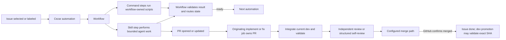

# Factory default workflow and ownership

This guide describes the default path from an issue entering the Factory queue through implementation, review, merge to `dev`, and later promotion. It is the overview of how jobs, workflow steps, and PR ownership fit together. The linked policies and workflow definitions remain authoritative for exact behavior.

## The shape of a Factory job

Factory work is a label-event pipeline. GitHub lifecycle labels route an issue to a Cezar automation; the automation runs a named workflow; that workflow combines command steps with one or more skill steps.

An ordinary issue edit is not a workflow trigger. A lifecycle label is the trigger; type, risk, complexity, and other routing labels are the filter envelope. State transitions and timeouts are configured in `policies/lifecycle.json` and summarized in [lifecycle.md](lifecycle.md).

### Who owns each layer?

| Layer | Owner | Responsibility |
|---|---|---|
| Queue selection | The event automation or the bounded maintenance workflow | An event automation receives the issue selected by its trigger. Hourly maintenance catches up one oldest eligible intake issue and refreshes one stale workable issue per run; it does not choose an entire implementation backlog. For an explicit request to work the backlog, the active job selects the next eligible issue using readiness, dependencies, priority, and age. |
| Automation | Cezar | Filters a lifecycle event or schedule, applies its runner/model/worktree settings, and starts the configured workflow for the issue it selected. It is a dispatcher, not the owner of the work product. |
| Workflow | The named Factory workflow | Defines ordered skill and command steps, artifacts, timeouts, retries, validation, and legal state routing. A command step runs scripts; a skill step performs bounded agent work. |
| Issue job | The plan, implementation, review, fix, or investigation run | Owns its issue outcome and evidence. Implementation and fix jobs additionally own the PR through confirmed merge, including work that must continue after a workflow handoff. A reviewer evaluates a head but does not take PR ownership. |
| Lifecycle router | Deterministic workflow command steps and `policies/lifecycle.json` | Validates structured results, enforces legal transitions and a single state label, and records evidence. An agent writes its result artifact; it does not set lifecycle labels. |
| Delivery tracker | Hourly `factory-maintenance` workflow | Mirrors PR progress to linked issues and closes an issue only after its non-draft PR into `dev` is merged. It is bookkeeping, not a substitute PR owner. |
| Development promotion | Bazzite `factory-local-promotion` timer | Validates a merged `dev` SHA, activates the development channel, runs canaries, then promotes and deploys according to release policy. The implementation job ends at merge to `dev`; it does not operate this timer. |

The maintenance queue and a user-directed backlog session are different selectors. Maintenance is deliberately bounded and oldest-first for intake; stale retries prioritize lower `priority:N` values, then least recently updated. The explicit backlog instruction in `AGENTS.md` selects by readiness, dependencies, priority, and age and continues on independent work while one issue waits. See [backlog-priority.md](backlog-priority.md) and [backlog-scheduling.md](backlog-scheduling.md) for the scheduler model; do not infer that the hourly maintenance workflow implements that whole ranking model.

### Which job owns which work?

- **The automation run owns its selected issue.** It consumes the prepared issue context and does not repeat broad issue discovery or create replacement tasks.
- **The workflow owns Factory scripts.** Every Factory script is called from a workflow `command:` step. A skill or prompt performs its bounded agent task; it does not tell the model to run Factory scripts or manually change lifecycle labels.
- **The implementation job owns its PR until it merges.** Review is a gate, not a handoff of PR ownership. The fix-review job continues the existing PR after requested changes. A PR being opened, reviewed, approved, or queued for auto-merge is not delivered work; delivery is GitHub reporting `MERGED`.
- **The scheduler owns backlog selection.** When the user asks for outstanding work, Factory selects the next eligible item from the queue using readiness, dependencies, priority, and age. A blocked issue does not stop independent work.
- **The promotion timer owns development-to-stable promotion and deployment.** Implementation jobs merge into `dev`; they do not move release pointers or deploy a production target.

For local interactive Windows work, follow `skills/factory-workspace/SKILL.md`: inspect the one existing checkout, preserve unrelated changes, and use a fresh task branch. A directly requested local checkout does not need a registry claim. Cezar-runner work uses the fenced workspace claim/adopt flow. Do not create replacement tasks for work a Factory automation already selected.

## Default issue lifecycle

The exact states, legal exits, owners, and deadlines are data in `policies/lifecycle.json`; this summary is intentionally not a second state table.

| Stage | Default owner | What the job does | Normal handoff |
|---|---|---|---|
| Intake | `factory-intake` | Classifies the selected issue, preserves project labels, assigns type/risk, and routes it for planning or a valid exceptional state. | `factory:needs-plan` |
| Planning | `factory-plan` | Reads issue context and dependencies, identifies the touched architecture, writes testable acceptance criteria and non-goals, and chooses a complexity tier. | `factory:ready` plus one `complexity:*` label, or a stated architectural decision at `factory:needs-help` |
| Implementation | `factory-implement` | Uses the approved plan and prepared context, implements in one agent session, runs the required validation matrix, applies bounded same-session repair when authorized, then publishes a PR only after the matrix passes and retains PR ownership. | `factory:review` while the linked PR remains open |
| Review | `factory-review` | Independently reviews the exact PR head, validates evidence and merge eligibility, and records actionable findings. It does not take over implementation or PR ownership. | `factory:changes-requested` for findings; otherwise the configured merge path |
| Review fixes | `factory-fix-review` | Updates the same PR, incorporates current `origin/dev`, resolves conflicts while preserving both sides, reruns validation, pushes, and returns the issue to review. | `factory:review` |
| Investigation | `factory-investigate` | Classifies repeated failures from evidence and determines a bounded retry, re-plan, or genuine blocker. Investigation must preserve any existing open PR and its owner; it must not turn a failed run into duplicate implementation work. | `factory:ready`, `factory:needs-plan`, a verified `factory:blocked`, or a specific major decision at `factory:needs-help` |
| Delivery | `factory-maintenance` and the PR owner | Tracks a pushed branch without a PR, tracks an open PR, and closes the referenced issue after the PR merges. | `factory:implemented` → `factory:pr-open` → `factory:done` |

The usual entry points are event-triggered intake for a specific issue and the hourly maintenance catch-up path for eligible backlog work. Intake classifies new issues; maintenance also refreshes one stale workable state so missed label events can be recovered. The lifecycle sweep repairs mechanical state errors, routes a conflicting PR to the configured conflict exit when the issue is in a state with one, and reports what it cannot safely infer. `factory:interactive` marks a local person-owned issue so stale sweeps leave it alone. See [lifecycle.md](lifecycle.md) for the generated state table and guard rules.

### What a workflow step does

Command steps own deterministic preparation, validation, persistence, and routing. They consume the raw `{{task}}` when a task identifier is needed, create bounded artifacts under `.factory/`, and enforce schemas or policy before a state changes. Skill steps receive the already-selected issue and its prepared context, perform the focused reasoning or code work, and write the result artifact requested by the workflow. They must not rediscover or replace selected work, run Factory scripts, or manually change `factory:*` state labels. A workflow can retry a named step within its configured budget; a retry does not create a new issue owner or release an open PR.

## How implementation reaches `dev`

The originating implement or fix job remains responsible through confirmed merge:

1. Start from the issue’s approved plan, prepared context, and assigned workspace. Keep changes scoped and preserve unrelated edits.
2. Make the change and add meaningful coverage. The default implement workflow keeps the same live agent session open while command steps run the required checks. It records each check against the worktree artifact digest; any artifact change during validation invalidates that matrix.
3. The deterministic repair decision applies the bounded retry policy and progress evaluator. An authorized repair or replan returns focused findings to the same session, then reruns the full required matrix. Stagnation, regression, oscillation, exhausted budget, infrastructure errors, or an unavailable session produce an incomplete handoff; they do not publish a PR. A green, unchanged matrix triggers a final continuation asking that session to commit, open/update a PR targeting `dev`, and write the structured result.
4. Keep the workflow's issue stage and PR ownership intact. Include `Closes #N` for every issue fully delivered and keep the issue in review while the linked PR is open.
5. Before review handoff, fetch `origin/dev` and merge it into the PR branch. Resolve conflicts by retaining both sides’ intent, rerun validation on the integrated result, push it, and confirm the PR is mergeable. Do not rebase an already-pushed branch or discard the other job’s work to clear a conflict.
6. Record a structured self-review on the PR when no independent maintainer is available. It must cover scope, risk, important invariants, validation evidence, and unresolved findings. If an independent reviewer is available, use that reviewer. Failed validation or unresolved findings block merge.
7. Verify the PR head is the exact pushed, validated commit and that GitHub reports it mergeable. Follow the configured merge path and keep owning the PR until GitHub reports `MERGED` with a merge commit. If auto-merge is queued but the PR stays open, continue to own it and repair/revalidate any later conflict.
8. Confirm the merged change is on `origin/dev`. Only then mark implementation delivery complete. Roll the local checkout forward to `origin/dev` before starting unrelated work.

For broken code—a failing test, workflow, deploy, runtime, or regression—the repository instructions require the owner to squash-merge directly after local validation and structured self-review, rather than waiting for auto-merge. Confirm the exact head and `MERGEABLE`/`CLEAN` state first. For other changes, use the configured reviewed merge path; an auto-merge request is still only a request until the merged state is observed. These repository-specific merge rules are defined in `AGENTS.md` and the review workflow.

An issue with an open PR must stay attached to that PR through retries and investigation. A model/session failure may change the next step, but must not release the PR owner, re-plan the same work as a replacement, or leave the PR without a repair/merge continuation.

## Validation before merge

Validation runs on Factory compute. This repository has no hosted CI: do not trigger, wait on, poll, or cite GitHub Actions or status checks.

- The local validation suite is `tests/run-tests.ps1`; the `.githooks` pre-commit hook runs fast static checks and YAML lint. `scripts/factory/test-changed.ps1` and the release promotion gate provide their configured validation receipts. See [local-validation.md](local-validation.md) for environment details and current receipts.
- After a Factory-managed change has passed validation, its implementation PR targets `dev` and includes the appropriate review evidence.
- Before merging changes to `scripts/`, `tests/`, `workflows/`, `automations/`, `policies/`, or `config/`, run `.claude/ship/ship-loop.ps1 -Action Validate` from the dev window for the pushed PR head. It runs the Linux full suite on that exact SHA and writes a receipt under `.factory/ship-loop/receipts/`. Quote the `VALIDATE_PASSED` line in the PR conversation. Do not merge a failed or stale-head validation.
- Local or Linux validation evidence is bound to a commit. If the branch changes after validation, validate the new head before merge.

## After merge: promotion and release

Merging into `dev` is the end of the implementation PR, not a live production deployment. The Bazzite host’s `factory-local-promotion` timer owns the next stages: it validates the exact merged SHA with the full local suite, activates the development channel, runs canary jobs, then fast-forwards `origin/stable` and deploys only if the canary passes. A failed canary rolls back `dev`, quarantines the SHA, and opens an issue. Do not run promotion by hand, set channel pointers, or edit the Bazzite checkout.

A **Production Run** or explicit live-deployment request selects the controlled posture and `factory-finish-release` flow. It requires the configured targets and review gates and stops on failed validation or mismatched/dirty checkouts. Production gates do not block ordinary development PRs or development-channel updates. See [promotion-pipeline.md](promotion-pipeline.md) and [factory-release-controller.md](factory-release-controller.md).

## Other recurring workflows

These workflows support the default issue path but do not replace it:

| Workflow | Purpose | Ownership boundary |
|---|---|---|
| `factory-maintenance` | Scheduled intake, stale-state refresh, lifecycle/conflict sweep, and repository maintenance. | Mechanical backlog repair; it should not silently reimplement a live PR. |
| `factory-verify` | Selects impacted plus mandatory project checks, invokes them, and records a policy verdict. | Runs as a workflow with command steps and no agent. |
| `factory-health` | Read-only failure and backlog health summary; publishes bounded Factory-defect evidence. | Does not fix code or deploy. |
| `factory-release-fix-pr` | Opens a release repair PR from a failure report. | Submission is an intermediate result; the repair owner continues until the PR merges. |
| `factory-godot-upgrade` | Checks, stages, tests, and opens a PR for a stable Godot update. | The upgrade job owns its PR through its configured merge path. |

## Known process gaps

The ownership rule is clear in `AGENTS.md` and the implementation/fix skills, but open-PR ownership is not yet durable across every Cezar run failure. A failed run can move an issue with a still-open PR to `factory:investigate`. Investigation can then re-plan the issue, while the lifecycle sweep only routes a conflicting PR for repair when its issue is still in review. In that case, the PR can lose its automatic repair/merge trigger, and another implementation can create duplicate work.

Until the workflow/state model closes this gap, a failure on an issue with an open PR must resume that same PR and owner path; do not create replacement implementation work or consider the issue delivered. The intended fix is a persistent PR-to-owner relationship plus a recovery route that detects open PRs even when their issue has left `factory:review`. See `scripts/sweep-lifecycle.ps1` and `policies/lifecycle.json` alongside the PR-ownership rules in `AGENTS.md`.

## User decisions and blockers

Routine ambiguity uses the safest reversible assumption and is recorded. Risk level alone does not pause work. Ask the user only about a major unresolved choice that materially changes compatibility, ownership, or the system contract. A verified external dependency can block one issue; continue other eligible work. Independent review is a technical gate, not a user-approval step.

## Sources of truth

When this guide is updated, check the sources below rather than inferring behavior from this overview:

| Topic | Primary sources |
|---|---|
| Issue stages, owners, deadlines | `policies/lifecycle.json`, `scripts/lifecycle-lib.ps1`, `scripts/sweep-lifecycle.ps1`, [lifecycle.md](lifecycle.md) |
| Queue selection and automation-to-workflow routing | `automations/intake.json`, `automations/maintenance.json`, `automations/needs-plan-*.json`, `automations/ready-to-implement-*.json`, `automations/ready-to-review.json`, `automations/changes-requested.json`, `routing/automation-catalog.json`, `scripts/select-intake-issue.ps1`, `scripts/refresh-stale-workable.ps1`, [backlog-priority.md](backlog-priority.md), [backlog-scheduling.md](backlog-scheduling.md) |
| Workflow steps and artifacts | `workflows/intake.yaml`, `workflows/plan.yaml`, `workflows/implement.yaml`, `workflows/review.yaml`, `workflows/fix-review.yaml`, `workflows/investigate.yaml`, `workflows/maintenance.yaml`, `scripts/route-state.ps1` |
| Agent and PR ownership rules | `AGENTS.md`, `skills/factory-plan/SKILL.md`, `skills/factory-implement/SKILL.md`, `skills/factory-review/SKILL.md`, `skills/factory-fix/SKILL.md`, `skills/factory-workspace/SKILL.md` |
| Validation and merge receipts | [local-validation.md](local-validation.md), [validation-receipts.md](validation-receipts.md), `scripts/factory/test-changed.ps1`, `scripts/verify-merge-eligibility.ps1`, `scripts/route-state.ps1` |
| Release and promotion | `config/promotion-policy.json`, [promotion-pipeline.md](promotion-pipeline.md), [factory-release-controller.md](factory-release-controller.md), `skills/factory-finish-release/SKILL.md` |
| Verification-only job | `workflows/verify.yaml`, [verification-workflow.md](verification-workflow.md) |
| Workflow-guide upkeep | `skills/factory-update-workflow-guide/SKILL.md`, `skills/factory-plan/SKILL.md`, `skills/factory-implement/SKILL.md` |

## Keeping this guide current

Use the `factory-update-workflow-guide` skill whenever a change alters issue routing, workflow ownership, job/step responsibilities, PR creation or merge, validation evidence, or release/promotion behavior. The skill reconciles this guide against the sources of truth above and records a known gap when those sources disagree; it does not silently resolve policy or change workflow behavior. Planning and implementation guidance route process changes through this documentation check.
